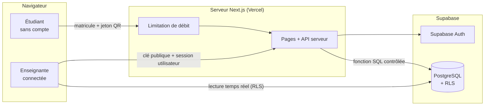
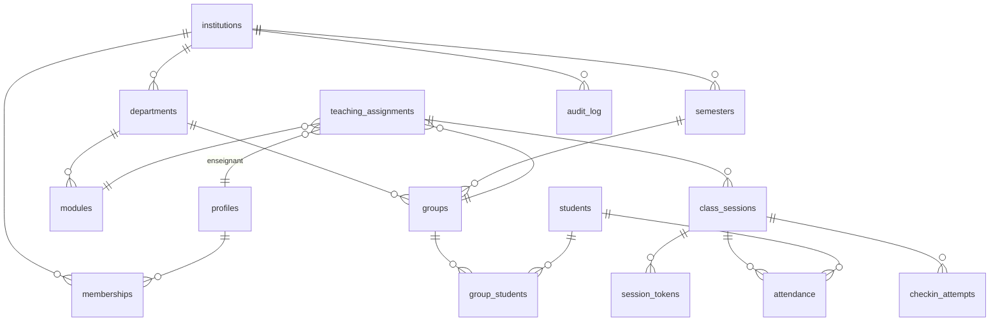
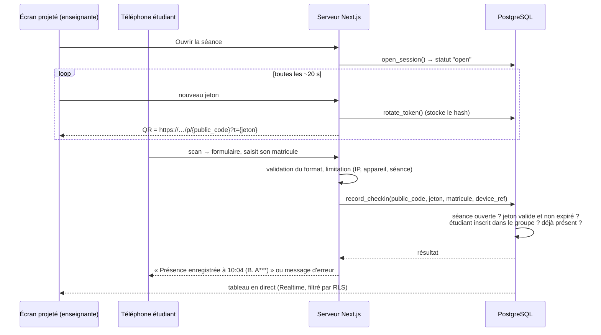

# Phase 1 — Architecture, schéma de données, rôles et risques

> Statut : **document de conception**. Rien n'est encore implémenté, testé ni déployé.
> Les choix ci-dessous seront vérifiés par des tests à partir de la phase 2.

---

## 1. Vue d'ensemble (en langage simple)

L'application a trois « morceaux » :

| Morceau | Rôle | Technologie |
|---|---|---|
| **Le navigateur** (téléphone ou PC) | Affiche les pages, le QR code, les formulaires | Next.js (React) |
| **Le serveur applicatif** | Reçoit les requêtes, vérifie, limite les abus, détient les secrets | Next.js (Route Handlers / Server Actions), hébergé sur Vercel |
| **La base de données** | Stocke tout et **refuse** elle-même les accès non autorisés | PostgreSQL chez Supabase + Auth + RLS |



### Deux principes structurants

1. **La base de données est la dernière ligne de défense.** Chaque table a la
   RLS activée. Même si quelqu'un appelle directement l'API Supabase avec la
   clé publique (ce qui est toujours possible, la clé est dans le navigateur),
   il ne voit que ce que les politiques autorisent.
2. **Les étudiants ne touchent jamais directement la base.** Leur formulaire
   envoie la demande au serveur Next.js, qui limite les abus puis appelle une
   seule fonction SQL (`record_checkin`) avec la clé secrète. Cette fonction
   n'est pas appelable avec la clé publique.

### Les clés Supabase

| Clé | Où ? | Peut-elle être vue ? |
|---|---|---|
| URL du projet + clé **publishable** (anciennement `anon`) | Navigateur et serveur | Oui, c'est normal. La RLS protège. |
| Clé **secret** (anciennement `service_role`) | **Uniquement** variables d'environnement du serveur | **Jamais.** Elle contourne la RLS. |

Règle de code : la clé secrète n'est lue que dans un fichier marqué
`import "server-only"` ; aucune variable la contenant ne commence par
`NEXT_PUBLIC_`. Un test automatique vérifiera que le bundle navigateur ne la
contient pas.

---

## 2. Modèle multi-établissements

### Principe

- Chaque donnée métier porte une colonne **`institution_id`**.
- Un utilisateur obtient l'accès à un établissement via une ligne dans
  **`memberships`** (établissement, utilisateur, rôle).
- Les clés étrangères sont **composites** `(institution_id, id)` : il est
  physiquement impossible en base de rattacher une séance de l'établissement A
  à un groupe de l'établissement B, même par erreur de code.

### Rôles (V1 volontairement réduite à deux)

| Rôle | Portée | Exemple |
|---|---|---|
| `admin` | Tout l'établissement (et seulement lui) | Responsable de l'espace |
| `enseignant` | Les groupes/modules qui lui sont **affectés** | Vous, pour vos cours |

- Une même personne peut être `admin` **et** `enseignant` dans un
  établissement, et `enseignant` dans un autre.
- Pas de « super-administrateur » dans l'application : l'administration de la
  plateforme se fait par la console Supabase, hors application.
- Un rôle `responsable_departement` est prévu dans le schéma (colonne
  `department_id` facultative sur `memberships`) mais **non activé en V1**,
  pour éviter la complexité.
- Les **étudiants n'ont pas de compte** en V1.

### Matrice des permissions (V1)

| Donnée | admin (son établissement) | enseignant | étudiant (anonyme) |
|---|---|---|---|
| Établissement, départements, semestres | lire / modifier | lire | — |
| Membres et rôles | lire / modifier | lire sa propre ligne | — |
| Modules, groupes | lire / modifier | lire ceux qui lui sont affectés | — |
| Étudiants, inscriptions aux groupes | lire / modifier / importer | lire / importer **dans ses groupes** | — |
| Affectations (qui enseigne quoi) | lire / modifier | lire les siennes | — |
| Séances | lire toutes | créer / ouvrir / clôturer **les siennes** | — |
| Présences | lire toutes | lire / corriger (avec justification) **ses séances** | enregistrer **sa** présence via `record_checkin` uniquement |
| Journal d'audit | lire | lire ce qui concerne ses séances | — |
| Autre établissement | **rien** | **rien** | — |

Aucune suppression physique de présences ni d'entrées d'audit depuis
l'application.

---

## 3. Schéma de données

Conventions : clés primaires `uuid`, dates en `timestamptz` stockées en UTC,
affichées en `Africa/Algiers` (UTC+1, pas d'heure d'été) au format
JJ/MM/AAAA HH:mm. Toutes les tables ont `created_at`.



### Tables

**`institutions`** — un établissement (ou un espace de travail personnel au départ)
- `id`, `name`, `slug` (unique), `timezone` (défaut `Africa/Algiers`),
  `retention_months` (défaut 36), `created_by`.

**`profiles`** — complément de `auth.users` (géré par Supabase Auth)
- `id` = `auth.users.id`, `full_name`. **Pas** de téléphone, adresse, etc.

**`memberships`**
- `institution_id`, `user_id`, `role` (`admin` | `enseignant`),
  `department_id` (nullable, réservé), `status` (`active` | `disabled`).
- Contrainte : `unique (institution_id, user_id, role)`.

**`departments`** — `institution_id`, `name`; `unique (institution_id, name)`.

**`semesters`** — `institution_id`, `label` (« 2026-2027 S1 »), `start_date`, `end_date`;
`check (end_date > start_date)`.

**`modules`** — `institution_id`, `department_id`, `code`, `name`;
`unique (institution_id, code)`.

**`groups`** — `institution_id`, `department_id`, `semester_id`, `name`
(« L2 Info — G1 »), `level`; `unique (institution_id, semester_id, name)`.

**`students`** — `institution_id`, `matricule`, `last_name`, `first_name`,
`active`.
- `unique (institution_id, matricule)` ; matricule normalisé (majuscules,
  sans espaces) par une contrainte `check`.
- **Pas** de date de naissance, téléphone, e-mail, photo en V1.

**`group_students`** — `institution_id`, `group_id`, `student_id`;
clé primaire `(group_id, student_id)`.

**`teaching_assignments`** — « qui enseigne quoi à qui »
- `institution_id`, `teacher_id`, `module_id`, `group_id`,
  `session_type` (`cours` | `td` | `tp`).
- `unique (teacher_id, module_id, group_id, session_type)`.
- C'est **cette table** qui détermine ce qu'un enseignant peut voir.

**`class_sessions`** — une séance
- `institution_id`, `assignment_id`, `scheduled_at`, `room` (facultatif),
  `status` (`planned` | `open` | `closed` | `cancelled`),
  `opened_at`, `closed_at`, `checkin_closes_at`,
  `public_code` (identifiant court non devinable utilisé dans l'URL du QR),
  `fallback_code` (code à 6 chiffres pour la saisie manuelle si le QR échoue).
- `check` : `closed_at >= opened_at`.

**`session_tokens`** — jetons QR tournants
- `session_id`, `token_hash` (SHA-256, jamais le jeton en clair),
  `expires_at`. Un nouveau jeton toutes les ~20 s, accepté ~45 s.

**`attendance`** — une ligne par (séance, étudiant)
- `institution_id`, `session_id`, `student_id`,
  `status` (`present` | `retard` | `absent` | `excuse`),
  `source` (`qr` | `code_secours` | `manuel` | `import_papier`),
  `recorded_at` (**heure du serveur** : `default now()`, non modifiable par le client),
  `device_ref` (hash d'un identifiant aléatoire posé en cookie sur le téléphone),
  `flags` (ex. `appareil_partage`), `updated_by`, `updated_at`.
- **`unique (session_id, student_id)`** → impossible d'avoir deux présences
  pour le même étudiant dans la même séance (détection des doublons garantie
  par la base, même en cas de requêtes simultanées).

**`checkin_attempts`** — tentatives (réussies ou non) pour la limitation de débit et l'analyse
- `session_id`, `ip_hash` (hash salé, pas l'IP en clair), `device_ref`,
  `matricule_hash`, `result` (`ok` | `jeton_expire` | `inconnu` | `doublon` | `limite` …),
  `created_at`. **Purgé automatiquement après 30 jours.**

**`audit_log`** — journal append-only
- `institution_id`, `actor_id`, `action`, `table_name`, `row_id`,
  `old_values`, `new_values` (jsonb), `reason` (obligatoire pour une
  correction manuelle), `created_at`.
- Rempli par des **triggers** en base (pas par le code de l'interface).
  Aucun `update` / `delete` autorisé, même pour un admin.

### Index principaux

- `memberships (user_id)` — utilisé dans *chaque* contrôle RLS.
- `teaching_assignments (teacher_id)`, `(group_id)`.
- `students (institution_id, matricule)` (via la contrainte unique).
- `group_students (student_id)`.
- `class_sessions (assignment_id, scheduled_at)`, `(public_code)` unique.
- `session_tokens (session_id, expires_at)`.
- `attendance (session_id)`, `(student_id)`.
- `checkin_attempts (session_id, created_at)`, `(ip_hash, created_at)`.
- `audit_log (institution_id, created_at)`.

---

## 4. Stratégie RLS (sécurité en base)

1. `alter table … enable row level security` sur **toutes** les tables du
   schéma `public`. Un test échouera si une table l'oublie.
2. Fonctions d'aide placées dans un schéma `private` (non exposé par l'API),
   `security definer`, `stable`, avec `set search_path = ''` :
   - `private.is_member(inst uuid)`
   - `private.has_role(inst uuid, role text)`
   - `private.teaches_group(group uuid)`
   - `private.owns_session(session uuid)`
3. Exemple de politique (lecture des présences) :
   ```sql
   create policy attendance_select on public.attendance
   for select to authenticated
   using (
     private.has_role(institution_id, 'admin')
     or private.owns_session(session_id)
   );
   ```
4. Le rôle `anon` (étudiants non connectés) n'a **aucun** droit sur aucune
   table. Les droits par défaut sur le schéma `public` seront révoqués
   explicitement.
5. Les opérations sensibles passent par des fonctions SQL dédiées :
   - `create_workspace(name)` : crée l'établissement + rend l'utilisateur
     `admin` et `enseignant` (sinon il ne pourrait pas s'ajouter lui-même).
   - `open_session`, `close_session`, `rotate_token`.
   - `correct_attendance(id, new_status, reason)` : exige une justification
     non vide, écrit l'audit.
   - `record_checkin(...)` : **exécutable uniquement par le serveur** (rôle
     `service_role`), voir §5.

Vérification prévue (phase 3) : deux établissements fictifs A et B, des
utilisateurs dans chacun, et pour **chaque table** des tentatives
`select / insert / update / delete` croisées — à la fois en SQL (en simulant
le JWT) **et** par des requêtes HTTP directes à l'API REST Supabase avec la
clé publique, sans passer par l'interface.

---

## 5. Parcours de présence par QR code



Points importants :
- L'**heure enregistrée** est celle du serveur de base (`now()`), jamais celle
  du téléphone.
- Les messages d'erreur sont volontairement vagues (« matricule non reconnu
  pour cette séance ») pour ne pas permettre de deviner qui est inscrit.
- La confirmation affiche seulement une initiale et une partie du nom.
- **Procédure de secours** si le réseau ou le QR ne fonctionne pas :
  1. code à 6 chiffres affiché à l'écran + adresse courte à saisir à la main ;
  2. sinon appel nominal sur l'interface de l'enseignante (cocher les présents),
     enregistré avec `source = manuel` ;
  3. sinon feuille papier imprimable (liste du groupe), ressaisie ensuite avec
     `source = import_papier`.
  La page enseignante supporte une coupure courte : les corrections faites
  hors ligne sont mises en file et renvoyées au retour du réseau, avec
  indication claire « non synchronisé ».

---

## 6. Principaux risques et réponses prévues

| # | Risque | Réponse V1 | Limite honnête |
|---|---|---|---|
| 1 | **Fraude « par procuration »** : un étudiant présent saisit le matricule d'un absent | Signalement si un même appareil enregistre plusieurs matricules ; vérification visuelle possible (effectif affiché vs. personnes présentes) ; correction par l'enseignante | Le matricule **n'est pas** une preuve d'identité ; impossible à empêcher totalement sans compte étudiant ou contrôle humain |
| 2 | **QR photographié et envoyé** (WhatsApp) à un absent | Jeton tournant de ~20 s, fenêtre de pointage limitée (ex. 15 min) | Retarde la fraude, ne l'empêche pas : le QR **ne prouve pas** la présence physique |
| 3 | **Fuite entre établissements** | `institution_id` partout, FK composites, RLS, tests d'accès croisé par l'API | La sécurité dépend de tests exhaustifs ; à revérifier à chaque migration |
| 4 | **Clé secrète exposée** | `server-only`, pas de `NEXT_PUBLIC_`, test du bundle, rotation de clé documentée | Une fuite par erreur humaine (capture d'écran, dépôt Git) reste possible → `.env` dans `.gitignore`, scan de secrets |
| 5 | **Soumissions massives / robots** | Limitation par IP hashée, par appareil, par séance ; validation stricte des entrées | Une limitation en base convient pour un petit volume ; à revoir si forte croissance |
| 6 | **Réseau faible en salle** | Pages très légères, code de secours, appel manuel, papier | Si ni l'enseignante ni les étudiants n'ont de connexion, seule la feuille papier fonctionne |
| 7 | **Modification abusive des présences** | Correction uniquement via fonction avec justification ; audit par trigger ; pas de suppression | Un admin malveillant de l'établissement peut toujours corriger (mais c'est tracé) |
| 8 | **Données personnelles** | Minimum : matricule, nom, prénom. IP et appareils hashés, purgés à 30 jours | Conformité à la **loi algérienne n° 18-07** (protection des données personnelles) à valider avec l'établissement : déclaration éventuelle auprès de l'ANPDP, information des étudiants, hébergement hors d'Algérie |
| 9 | **Perte de données** | Sauvegardes Supabase + export `pg_dump` chiffré périodique, test de restauration documenté | Le plan gratuit Supabase offre peu de garanties de sauvegarde et met en pause les projets inactifs → plan payant ou sauvegarde externe à prévoir avant usage réel |
| 10 | **Erreurs de fuseau / dates** | UTC en base, conversion `Africa/Algiers` à l'affichage, format JJ/MM/AAAA testé | — |
| 11 | **Import Excel malformé** | Aperçu avant validation, rapport ligne par ligne, transaction tout-ou-rien, limite de taille | — |
| 12 | **Injection de formules dans les exports** (`=…` dans un nom) | Échappement des cellules commençant par `= + - @` | — |

### Politique de conservation (proposition par défaut, configurable)

| Donnée | Durée |
|---|---|
| Tentatives de pointage (`checkin_attempts`) | 30 jours |
| Jetons QR | supprimés à la clôture + 1 jour |
| Présences et audit | `retention_months` de l'établissement (36 mois par défaut), puis anonymisation |
| Étudiants inactifs | anonymisés avec leurs présences au-delà de la durée |

---

## 7. Structure du projet prévue (phase 2)

```
presence-qr/
  supabase/
    migrations/        ← fichiers SQL numérotés (schéma, RLS, fonctions)
    tests/             ← tests SQL d'isolation (données fictives)
    seed.sql           ← données fictives uniquement
  src/
    app/               ← pages Next.js (enseignante, /p/[code] étudiant)
    lib/supabase/      ← client navigateur / client serveur (server-only)
    lib/               ← dates, import, export
  tests/               ← tests applicatifs et tests API d'accès croisé
  docs/
```

Outils : Next.js + TypeScript, `@supabase/ssr`, `zod` (validation),
`qrcode`, `exceljs` (lecture/écriture XLSX), Vitest. Supabase CLI pour les
migrations et une base locale de test.

---

## 8. Ce qui est **hors V1** (volontairement)

Comptes étudiants, invitations d'autres enseignants par e-mail, rôle chef de
département, géolocalisation, application mobile native, statistiques
avancées, facturation SaaS. Le schéma ne les empêche pas.
